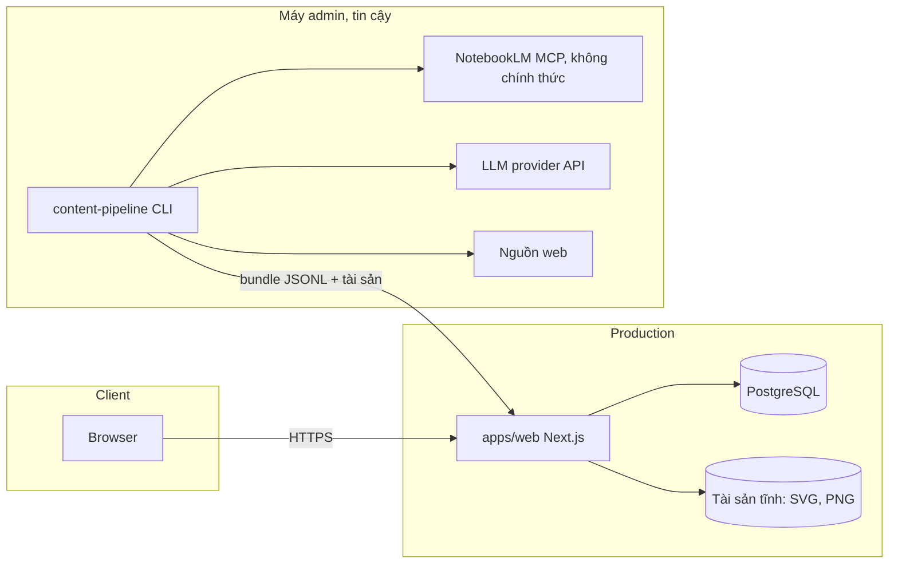
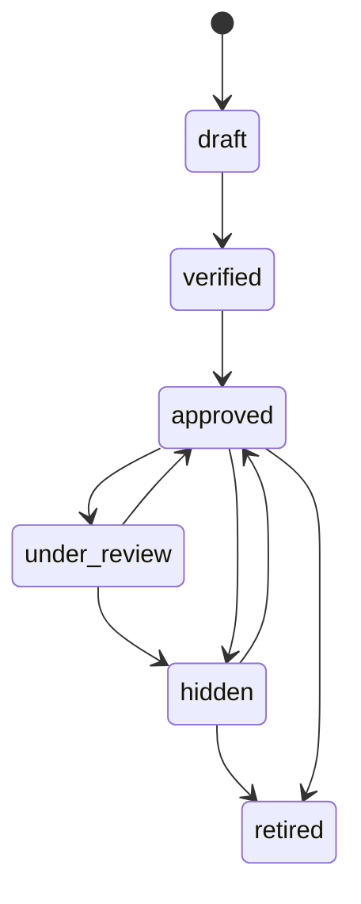
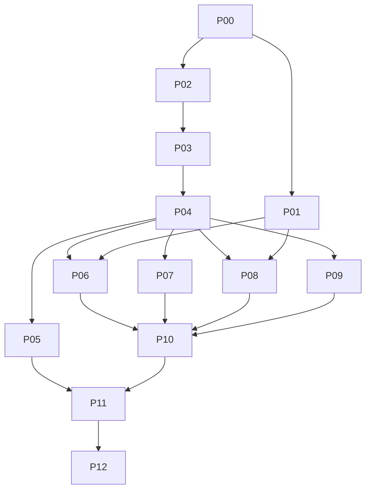

# IMPLEMENTATION_PLAN.md

Dự án: Web ôn thi cho 5 môn Dược (Hóa phân tích 1, Hóa hữu cơ 2, Giải phẫu sinh lý, Kinh tế chính trị, Vi sinh ký sinh 1)

Phiên bản: 0.1 DRAFT, ngày 2026-11-12
Nguồn gốc: PRD v0.1 trong cuộc trò chuyện này. PRD chưa được chủ dự án duyệt chính thức và 7 câu hỏi mở Q1 đến Q7 chưa có câu trả lời. Mọi thứ phụ thuộc vào chúng được ghi là ASSUMPTION hoặc PROPOSED và có cổng quyết định (decision gate) trước phase liên quan.

Các nhãn dùng trong tài liệu

| Nhãn | Nghĩa |
|---|---|
| CONFIRMED | Chủ dự án đã nói rõ |
| ASSUMPTION | Giả định làm việc để kế hoạch đủ cụ thể, cần xác nhận |
| PROPOSED | Đề xuất thiết kế (kiến trúc, schema, API), chưa được duyệt |
| OPEN | Chưa có thông tin, không được tự quyết |
| VERIFY | Tên hoặc phiên bản công cụ phải kiểm tra lại lúc triển khai, không dựa vào tài liệu này |

---

## 1. Mục đích và phạm vi

Mục đích. Xây một web luyện đề giúp một sinh viên Dược năm 2 đạt trên 8/10 ở 5 môn. Kiến thức nằm trong NotebookLM. Câu hỏi được AI sinh từ kho kiến thức đó và từ web, rồi được duyệt trước khi người học thấy.

Trong phạm vi MVP (PROPOSED, theo PRD mục 3): trắc nghiệm A/B/C/D cho cả 5 môn; bài tính có kiểm chứng tự động; câu nhìn hình viết danh pháp (Hóa hữu cơ 2); câu chỉ bộ phận trên hình 2D (Giải phẫu sinh lý); giải thích kèm nguồn; thi thử có bấm giờ; thống kê theo chủ đề; ôn câu sai; báo lỗi và duyệt câu hỏi.

Ngoài phạm vi: thanh toán, app native, diễn đàn, chấm tự luận bằng AI, công khai nội dung giáo trình có bản quyền. Post-MVP: mô hình 3D, lặp lại ngắt quãng, lớp học nhiều người, offline, xuất PDF, dạng bài cơ chế và hoàn thành phản ứng.

Tài liệu này là nguồn sự thật duy nhất cho Codex. Codex không được tự bịa yêu cầu sản phẩm. Gặp mục OPEN thì dừng và ghi vào `docs/blockers.md`.

---

## 2. Quyết định đã xác nhận, giả định và câu hỏi mở

### 2.1 CONFIRMED

| ID | Nội dung |
|---|---|
| C-01 | Năm môn: Hóa phân tích 1, Hóa hữu cơ 2, Giải phẫu sinh lý, Kinh tế chính trị, Vi sinh ký sinh 1 |
| C-02 | Mọi môn có câu trắc nghiệm A/B/C/D |
| C-03 | Hóa phân tích 1 có thêm dạng tính toán. AI tự lên đề từ kho kiến thức và từ web |
| C-04 | Hóa hữu cơ 2 có thêm dạng nhìn hình viết đáp án danh pháp |
| C-05 | Giải phẫu sinh lý có thêm dạng chỉ bộ phận trên hình. Mô hình 3D nếu làm được |
| C-06 | Kinh tế chính trị và Vi sinh ký sinh 1 theo mẫu chung |
| C-07 | NotebookLM là nguồn kiến thức, nối với AI agent bằng MCP |
| C-08 | Mục tiêu điểm trên 8/10 mỗi môn |
| C-09 | Quy trình làm việc: PRD, kiến trúc, dữ liệu/API, roadmap cho OpenAI Codex. Giai đoạn này chỉ lập kế hoạch |

### 2.2 ASSUMPTION (dùng làm mặc định cho đến khi chủ dự án đổi)

| ID | Giả định | Phụ thuộc câu hỏi |
|---|---|---|
| A-01 | Một tenant. Một admin (chủ dự án) và tùy chọn các tài khoản người học | Q3 |
| A-02 | Câu hỏi được sinh trước, duyệt, rồi mới phục vụ. Người học không kích hoạt sinh trực tiếp | Q6 |
| A-03 | Web responsive, chỉ dùng online | Q4 |
| A-04 | Dùng GitHub làm git host và CI, vì Codex làm việc trên repo GitHub | không có |
| A-05 | Hosting chi phí thấp, chưa chọn nhà cung cấp | Q5 |
| A-06 | Giao diện tiếng Việt, thuật ngữ kèm tiếng Anh/Latin khi cần | không có |
| A-07 | Nguồn trong NotebookLM là tài liệu chủ dự án được phép dùng cá nhân. Không commit nguồn có bản quyền vào repo | Q1 |
| A-08 | Giữ dữ liệu làm bài 24 tháng, audit log 12 tháng, backup 30 ngày | không có |
| A-09 | Mục tiêu RPO 24 giờ và RTO 4 giờ | không có |

### 2.3 Diễn giải cần chủ dự án xác nhận (D)

| ID | Diễn giải | Lý do |
|---|---|---|
| D-01 | NotebookLM là kho kiến thức. Hệ thống có một database riêng (PostgreSQL) chứa ngân hàng câu hỏi đã duyệt, lịch sử làm bài và tài khoản | PRD AC-7 yêu cầu luyện được khi NotebookLM hoặc AI lỗi. Điều đó cần ngân hàng câu hỏi lưu riêng. Chủ dự án ban đầu gọi NotebookLM là "database" |

### 2.4 OPEN (câu hỏi mở từ PRD mục 8)

| ID | Câu hỏi | Chặn phase |
|---|---|---|
| Q1 | Dùng MCP không chính thức cho NotebookLM được không? Nguồn trong notebook có được phép dùng không? | P01, P06 |
| Q2 | Cấu trúc đề thật mỗi môn (số câu, thời gian, tỉ lệ dạng bài, thang điểm, quy tắc danh pháp, quy tắc làm tròn). Có đề cương và đề cũ không | P05, P07, P08, P10 |
| Q3 | Ai dùng: chỉ chủ dự án, cả lớp hay công khai | P03 |
| Q4 | Thiết bị chính và có cần offline không | P02 (mặc định A-03) |
| Q5 | Ngân sách hosting và chi phí AI | P01, P06, P12 |
| Q6 | Sinh trước rồi duyệt hay sinh trực tiếp. Có cho dùng nguồn web và hình không rõ bản quyền không | P06 |
| Q7 | Hạn thi từng môn và hạn có MVP | thứ tự ưu tiên, không chặn |

---

## 3. Mã yêu cầu

FR-001 đến FR-026 lấy nguyên từ PRD. NFR, INT, MIG, AC được đánh mã ở đây để truy vết. Việc đánh mã không thay đổi nội dung PRD.

### 3.1 Yêu cầu chức năng

| ID | Tóm tắt |
|---|---|
| FR-001 | Kết nối kho kiến thức NotebookLM và truy vấn theo chủ đề |
| FR-002 | Taxonomy chủ đề theo đề cương, mỗi câu gắn chủ đề |
| FR-003 | Bổ sung kiến thức từ web, nguồn web gắn nhãn và phải duyệt |
| FR-004 | Sinh câu A/B/C/D, một đáp án đúng, có giải thích và nguồn |
| FR-005 | Trạng thái câu hỏi. Chỉ câu đã duyệt hoặc đã kiểm chứng hiện cho người học |
| FR-006 | Phát hiện câu trùng hoặc gần trùng |
| FR-007 | Độ khó dễ, vừa, khó |
| FR-008 | Bài tính sinh từ mẫu, đáp án do công cụ tính, không do mô hình ngôn ngữ |
| FR-009 | Đáp án nhiễu phản ánh lỗi sai thường gặp |
| FR-010 | Hiển thị công thức hóa học và toán |
| FR-011 | Hình cấu trúc dựng từ dữ liệu cấu trúc đã kiểm chứng |
| FR-012 | Câu nhìn hình viết danh pháp, chấm chấp nhận biến thể hợp lệ |
| FR-013 | Hiện đáp án chuẩn và giải thích tên gọi sau khi nộp |
| FR-014 | Câu chỉ bộ phận trên hình |
| FR-015 | Hình chỉ dùng nguồn có giấy phép, lưu nguồn và giấy phép |
| FR-016 | Mô hình 3D (post-MVP) |
| FR-017 | Kinh tế chính trị và Vi sinh ký sinh 1 theo quy trình chung |
| FR-018 | Chế độ luyện và chế độ thi thử |
| FR-019 | Tạo đề thi thử theo tỉ lệ chủ đề và dạng bài cấu hình được |
| FR-020 | Lưu kết quả và thống kê theo chủ đề |
| FR-021 | Ôn lại câu sai và câu đánh dấu |
| FR-022 | Báo lỗi câu hỏi và xử lý |
| FR-023 | Màn hình duyệt câu hỏi hàng loạt |
| FR-024 | Lệnh sinh câu hỏi hàng loạt theo chủ đề, có hạn mức chi phí |
| FR-025 | Nhật ký nguồn, mô hình và thời điểm sinh của từng câu |
| FR-026 | Đăng nhập và tiến độ riêng từng người (nếu có nhiều người dùng) |

### 3.2 Phi chức năng, tích hợp, di chuyển dữ liệu, tiêu chí MVP

| ID | Tóm tắt |
|---|---|
| NFR-01 | Khả năng truy cập: bàn phím, WCAG AA, văn bản thay thế cho hình |
| NFR-02 | Hiệu năng: trang tải tối đa 3 giây trên 4G, sinh mới tối đa 60 giây p95 |
| NFR-03 | Sẵn sàng khoảng 99% trong mùa thi. Luyện tập không phụ thuộc NotebookLM hay AI lúc chạy |
| NFR-04 | Quyền riêng tư: thu thập tối thiểu, tuân thủ luật Việt Nam nếu có người dùng khác |
| NFR-05 | Tiếng Việt, thuật ngữ kèm tiếng Anh/Latin khi cần |
| NFR-06 | Bảo mật: khóa không lộ, phân quyền, giới hạn tần suất, kiểm tra đầu vào |
| NFR-07 | Bản quyền: lưu nguồn và giấy phép từng tài liệu và hình |
| NFR-08 | Bảo trì: ngân hàng câu hỏi xuất nhập được, lớp kết nối kho kiến thức thay được |
| INT-01 | NotebookLM qua MCP, có phương án dự phòng xuất nguồn ra kho riêng |
| INT-02 | Tìm kiếm web có cơ chế duyệt nguồn |
| INT-03 | Dữ liệu cấu trúc phân tử đã kiểm chứng cho Hóa hữu cơ 2 |
| INT-04 | Thư viện hình và 3D có giấy phép cho Giải phẫu sinh lý |
| MIG-01 | Liệt kê nguồn, gán chủ đề, nhập đề cũ (nếu có), báo cáo độ bao phủ |
| AC-1 | Cả 5 môn có ngân hàng đã duyệt, bao phủ ít nhất 90% chủ đề taxonomy |
| AC-2 | Mẫu kiểm 100 câu mỗi môn đúng từ 98% trở lên. 100% bài tính được tính lại độc lập |
| AC-3 | Hành trình trọn vẹn: làm đề, xem đáp án và nguồn, thống kê, ôn câu sai |
| AC-4 | Câu danh pháp và câu chỉ bộ phận 2D chạy với hình hợp lệ về giấy phép |
| AC-5 | Thi thử có bấm giờ, nộp bài, phân tích chủ đề yếu |
| AC-6 | Báo lỗi và duyệt hoạt động, câu bị báo lỗi bị loại khỏi đề mới đến khi xử lý |
| AC-7 | Luyện tập vẫn dùng được khi NotebookLM hoặc AI không phản hồi |
| AC-8 | Đạt các NFR ở mục 3.2 |

---

## 4. Kiến trúc (PROPOSED)

### 4.1 ADR

Các ADR dưới đây được tạo thành file trong `docs/adr/` ở task P00-T05 với trạng thái ghi trong cột cuối.

| ADR | Quyết định | Trạng thái |
|---|---|---|
| ADR-0001 | Kiểu kiến trúc: modular monolith | PROPOSED |
| ADR-0002 | NotebookLM là nguồn kiến thức, PostgreSQL là nơi lưu ngân hàng câu hỏi | PROPOSED, chờ D-01 |
| ADR-0003 | Pipeline sinh câu hỏi chạy offline trên máy admin, bàn giao bằng bundle | PROPOSED |
| ADR-0004 | Một ngôn ngữ (TypeScript) trong monorepo pnpm | PROPOSED |
| ADR-0005 | ORM và migration: Drizzle ORM với SQL migration | PROPOSED |
| ADR-0006 | Hosting và Postgres | OPEN, chốt trong P01 (Q5) |
| ADR-0007 | Nhà cung cấp LLM | OPEN, chốt trong P01 (Q5, Q6) |
| ADR-0008 | Xác thực: nhà cung cấp OIDC qua thư viện Auth.js | PROPOSED, chờ Q3 |

**ADR-0001. Kiểu kiến trúc**

Bối cảnh. Đội ngũ rất nhỏ (một người cộng Codex). Tải thấp. Cần phân quyền theo đối tượng (người học chỉ xem bài của mình), luồng duyệt riêng cho admin và khả năng chạy tiếp khi dịch vụ AI lỗi.

| Phương án | Ưu | Nhược |
|---|---|---|
| A. Modular monolith: Next.js + PostgreSQL, một ứng dụng triển khai được | Một repo, một deploy, dễ test logic phân quyền bằng code, rẻ | Tự lo backup và vận hành DB |
| B. Next.js + BaaS (ví dụ Supabase) | Ít vận hành, có sẵn auth và lưu trữ | Phân quyền dồn vào chính sách ở DB khó test, phụ thuộc nhà cung cấp, luồng duyệt tùy biến vẫn phải tự viết |
| C. Site tĩnh + ngân hàng câu hỏi JSON, tiến độ lưu trong trình duyệt | Rẻ nhất, gần như không vận hành | Không có đăng nhập, không có giao diện duyệt, báo lỗi và thống kê bị hạn chế |

Quyết định đề xuất: A. Ngân hàng câu hỏi luôn xuất được ra bundle JSONL nên có thể lùi về C nếu Q3 hóa ra là "chỉ mình tôi". Chỉ xem lại B nếu Q5 nói không có ngân sách hosting nào và nhà cung cấp BaaS có gói miễn phí đủ dùng. Không dùng microservice vì không có áp lực nào cần tách.

**ADR-0002. Nguồn kiến thức và nơi lưu ngân hàng câu hỏi**

NotebookLM không dùng được như database runtime. Theo hiểu biết hiện tại không có API chính thức, MCP hiện có là của bên thứ ba và có thể hỏng khi giao diện đổi (VERIFY ở P01). Vì vậy NotebookLM chỉ được truy vấn lúc sinh câu hỏi. Câu hỏi đã duyệt nằm trong PostgreSQL. Kết quả: người học luyện được dù NotebookLM, MCP hay LLM ngừng hoạt động (AC-7, NFR-03).

**ADR-0003. Pipeline sinh câu hỏi**

| Phương án | Ưu | Nhược |
|---|---|---|
| a. Sinh trực tiếp trên server mỗi khi người học bấm làm đề | Nội dung mới liên tục | Phụ thuộc MCP không chính thức, chi phí khó kiểm soát, câu chưa duyệt đến tay người học |
| b. CLI chạy trên máy admin, xuất bundle, admin tải lên để duyệt | Phiên đăng nhập NotebookLM không rời máy admin, kiểm soát chi phí, bundle cũng là định dạng backup | Admin phải chạy tay |
| c. Worker định kỳ trên server | Tự động | Cần đưa phiên đăng nhập NotebookLM lên server, rủi ro bảo mật và điều khoản dịch vụ |

Quyết định đề xuất: b. Nếu sau này Q1 cho phép cách chính thức, có thể chuyển sang c bằng một adapter mới, không đổi phần còn lại.

### 4.2 Thành phần

| Thành phần | Vai trò | Vị trí |
|---|---|---|
| Web app (learner UI) | Chọn môn, làm đề, xem đáp án, thống kê | `apps/web` |
| Web app (admin UI) | Duyệt câu hỏi, xử lý báo lỗi, tải bundle lên | `apps/web` |
| API (route handlers) | REST JSON `/api/v1`, xác thực, phân quyền | `apps/web/src/app/api` |
| Domain core | Chấm điểm, vòng đời câu hỏi, chính sách phân quyền, lắp đề thi thử | `packages/core` |
| DB layer | Schema, migration, seed | `packages/db` |
| API contract | Schema zod dùng chung cho API, bundle, form | `packages/api-contract` |
| Calc engine | Mẫu bài tính và kiểm chứng | `packages/calc-engine` |
| Chem render | Dựng SVG cấu trúc từ SMILES, làm sạch SVG | `packages/chem-render` |
| Content pipeline | CLI sinh câu hỏi, adapter NotebookLM, adapter LLM, kiểm chứng, xuất bundle | `packages/content-pipeline` |
| PostgreSQL | Hệ thống lưu trữ chính | hạ tầng |
| Lưu trữ tài sản | Hình SVG, PNG, JPEG | thư mục tĩnh của app hoặc object storage (chốt ở ADR-0006) |

### 4.3 Luồng dữ liệu

Luồng sinh nội dung (offline, trên máy admin)
1. Admin chạy `content:generate` cho một môn và chủ đề.
2. CLI lấy đoạn kiến thức qua cổng `KnowledgeSource` (adapter NotebookLM MCP, hoặc adapter đọc thư mục xuất tay).
3. CLI gọi LLM qua cổng `LlmProvider`, nhận bản nháp có cấu trúc.
4. Bài tính đi qua calc-engine, câu danh pháp đi qua chem-render. Đáp án bài tính do code tính, không do LLM.
5. Các bước kiểm tra: schema, có trích dẫn nguồn, trùng lặp, đúng một đáp án đúng.
6. CLI ghi bundle (JSONL, tài sản, manifest có nguồn, mô hình, phiên bản, hash).

Luồng duyệt
7. Admin tải bundle lên `POST /api/v1/admin/imports`. Server kiểm tra lại toàn bộ, lưu câu hỏi ở trạng thái `draft`.
8. Admin duyệt trên giao diện, câu hỏi qua `verified` rồi `approved`.

Luồng người học
9. Người học tạo phiên luyện hoặc thi thử. Server chọn câu `approved`, trả đề không kèm đáp án đúng.
10. Người học gửi đáp án, server chấm, lưu `attempt_items`, trả phản hồi theo chế độ.
11. Người học báo lỗi một câu thì câu chuyển `under_review` và bị loại khỏi đề mới.

### 4.4 Ranh giới tin cậy

| Ranh giới | Quy tắc |
|---|---|
| Trình duyệt và server | Mọi đầu vào bị coi là không tin cậy. Xác thực, kiểm tra schema, kiểm tra quyền trên từng request |
| Người học và admin | Tách bằng vai trò. Endpoint `/admin/*` chỉ cho admin. Người học chỉ truy cập attempts của chính mình |
| Server và DB | Hai role DB. `app_rw` không được DDL và không được UPDATE hay DELETE trên `audit_logs`. `migrator` chỉ dùng khi migrate |
| Pipeline và thế giới bên ngoài | Nội dung từ NotebookLM, web và LLM là dữ liệu không tin cậy (có thể chứa chỉ dẫn độc hại). Chỉ được dùng làm dữ liệu, mọi đầu ra qua schema và kiểm chứng, không thực thi |
| Máy admin và server | Phiên NotebookLM, khóa LLM nằm trên máy admin. Server production không giữ chúng |

### 4.5 Triển khai



Môi trường: local (Docker Compose), CI (Postgres tạm), production. Staging là OPEN (Q5).

### 4.6 Stack (mọi phiên bản đều VERIFY lúc triển khai)

| Lớp | Lựa chọn đề xuất | Ghi chú |
|---|---|---|
| Runtime | Node.js bản LTS hiện hành | VERIFY, ghim bằng `.nvmrc` |
| Trình quản lý gói | pnpm (workspaces) | VERIFY |
| Ngôn ngữ | TypeScript, chế độ strict | VERIFY |
| Web | Next.js App Router, React | VERIFY phiên bản và API ổn định |
| DB | PostgreSQL, extension `pg_trgm`, `citext` | VERIFY phiên bản được nhà cung cấp hỗ trợ |
| ORM, migration | Drizzle ORM, drizzle-kit | VERIFY. Phương án thay: Prisma |
| Validation | zod | VERIFY |
| Auth | Auth.js (NextAuth) với nhà cung cấp OIDC | VERIFY, chờ Q3 |
| Công thức | KaTeX, kèm mhchem cho công thức hóa học | VERIFY |
| Dựng cấu trúc | RDKit JS (WASM) | VERIFY ở P01-T02. Phương án thay: script Python RDKit chạy offline |
| MCP client | SDK MCP chính thức cho TypeScript | VERIFY |
| Log | pino (JSON) | VERIFY |
| Test | Vitest, Playwright, axe-core | VERIFY |
| Hiệu năng | Lighthouse CI hoặc k6 | VERIFY, chọn trong P11 |
| Bảo mật CI | gitleaks, công cụ audit phụ thuộc (pnpm audit hoặc osv-scanner) | VERIFY |
| CI/CD | GitHub Actions | A-04 |

### 4.7 Giả định quy mô, nút thắt, chi phí

Giả định (PROPOSED): tối đa 100 người học đồng thời, tối đa 20.000 câu hỏi, tối đa 1 triệu dòng `attempt_items` mỗi năm. Một instance PostgreSQL là đủ.

Nút thắt dự kiến: truy vấn lắp đề thi thử (cần index theo môn, chủ đề, trạng thái); kích thước SVG và ảnh (cache tĩnh); thời gian sinh bài của LLM (chỉ ảnh hưởng admin vì sinh offline).

Chi phí chính: token LLM khi sinh hàng loạt (có hạn mức bắt buộc, FR-024), hosting và Postgres, lưu trữ và băng thông cho hình, tài sản 3D nếu làm sau MVP.

---

## 5. Cấu trúc repo (PROPOSED)

Chiến lược: một monorepo, trunk-based, nhánh ngắn cho mỗi phase, một commit hoặc PR cho mỗi ranh giới commit đã ghi.

```
.
├─ IMPLEMENTATION_PLAN.md
├─ AGENTS.md                       quy tắc cho Codex
├─ package.json
├─ pnpm-workspace.yaml
├─ tsconfig.base.json
├─ .nvmrc
├─ .env.example                    chỉ giá trị giả
├─ .github/workflows/ci.yml
├─ apps/
│  └─ web/
│     └─ src/
│        ├─ app/
│        │  ├─ (learner)/          trang người học
│        │  ├─ (admin)/            trang admin
│        │  └─ api/v1/             route handlers
│        ├─ components/            Question, Hotspot, MathText...
│        ├─ server/                services: attempts, content, auth, security
│        └─ config.ts              đọc và kiểm tra biến môi trường
├─ packages/
│  ├─ core/                        chấm điểm, vòng đời, authz, lắp đề
│  ├─ db/                          schema, migrations, seed
│  ├─ api-contract/                zod schemas, bundle schema
│  ├─ calc-engine/
│  ├─ chem-render/
│  └─ content-pipeline/            CLI, knowledge/, llm/, verify/, bundle/
├─ content/
│  ├─ taxonomy/                    <subject>.yaml do chủ dự án cung cấp
│  ├─ calc-templates/
│  └─ fixtures/                    dữ liệu tổng hợp (synthetic), không có tài liệu có bản quyền
├─ tests/e2e/
├─ infra/
│  └─ docker-compose.yml
└─ docs/
   ├─ adr/
   ├─ decision-register.md
   ├─ status.md
   ├─ blockers.md
   ├─ bundle-format.md
   ├─ runbooks/
   ├─ spikes/
   └─ change-requests/TEMPLATE.md
```

---

## 6. Thiết kế dữ liệu (PROPOSED)

Mô hình một tenant. Ranh giới phân quyền là vai trò (`learner`, `admin`) cộng quyền sở hữu đối tượng (attempts, reports thuộc về người tạo). Khóa chính dùng UUID, trừ khi ghi khác.

### 6.1 Thực thể

| Bảng | Cột chính | Ràng buộc và index |
|---|---|---|
| `subjects` | id, code, name | unique(code) |
| `topics` | id, subject_id FK, parent_id FK null, code, title, sort_order, syllabus_ref | unique(subject_id, code); index(subject_id, parent_id) |
| `sources` | id, subject_id FK, kind (notebooklm, web, upload, manual), title, locator, license, review_status (pending, approved, rejected), retrieved_at | index(subject_id), index(review_status); nguồn `web` phải `approved` trước khi trích dẫn |
| `assets` | id, kind (svg, png, jpeg, webp), storage_key, mime, width, height, source_id FK null, license, attribution, sha256, alt_text | unique(sha256); license NOT NULL khi được tham chiếu bởi câu `approved` |
| `questions` | id, subject_id FK, type (mcq, calc, name_from_structure, image_hotspot), difficulty (1 đến 3), status (draft, verified, approved, under_review, hidden, retired), current_revision_id FK, version int, created_at, updated_at | index(subject_id, status, type); index(status) |
| `question_revisions` | id, question_id FK, rev_no, stem, payload jsonb, explanation, content_hash, created_by FK, created_at | unique(question_id, rev_no); GIN trigram trên stem; unique(content_hash, question_id) |
| `question_choices` | revision_id FK, label (A đến D), text, is_correct | PK(revision_id, label); unique partial index trên (revision_id) where is_correct. Đúng một đáp án đúng được kiểm tra khi chuyển sang `verified` |
| `accepted_answers` | revision_id FK, answer_normalized, display, is_primary | PK(revision_id, answer_normalized) |
| `question_topics` | question_id FK, topic_id FK | PK(question_id, topic_id); index(topic_id) |
| `question_sources` | revision_id FK, source_id FK, locator | PK(revision_id, source_id, locator). Câu `verified` trở lên phải có ít nhất một dòng (FR-004) |
| `calc_templates` | id, subject_id FK, code, version, param_schema jsonb, status | unique(code, version) |
| `imports` | id, uploaded_by FK, bundle_hash, status, counts jsonb, report jsonb, created_at | unique(bundle_hash) |
| `users` | id, email (citext), display_name, role (learner, admin), status (active, disabled), created_at, last_login_at | unique(email) |
| `exam_blueprints` | id, subject_id FK, name, duration_seconds, spec jsonb, status | spec do chủ dự án cung cấp (Q2) |
| `attempts` | id, user_id FK, subject_id FK, mode (practice, mock, review), blueprint_id FK null, status (in_progress, submitted, expired), started_at, deadline_at null, submitted_at null, idempotency_key | unique(user_id, idempotency_key); index(user_id, started_at desc) |
| `attempt_items` | id, attempt_id FK, position, question_revision_id FK, answer jsonb null, is_correct bool null, answered_at null, time_spent_ms null, flagged bool | unique(attempt_id, position); index(question_revision_id) |
| `question_reports` | id, question_id FK, revision_id FK, reporter_id FK, reason (wrong_answer, ambiguous, typo, bad_image, other), note, status (open, accepted, rejected, resolved), resolved_by FK null, created_at | unique partial (reporter_id, question_id) where status = open |
| `audit_logs` | id bigserial, at, actor_user_id FK null, action, entity_type, entity_id, diff jsonb, request_id | append-only. `app_rw` chỉ có INSERT và SELECT |

Nội dung câu hỏi bất biến theo revision. `attempt_items` trỏ tới revision để lịch sử làm bài không đổi khi câu hỏi được sửa.

Payload theo loại (`question_revisions.payload`, kiểm tra bằng zod ở `packages/api-contract`):

| type | payload |
|---|---|
| mcq | `{}` (lựa chọn nằm ở `question_choices`) |
| calc | `{ template_code, template_version, params, computed_answer }` và lựa chọn ở `question_choices` |
| name_from_structure | `{ smiles, asset_id }` và đáp án ở `accepted_answers` |
| image_hotspot | `{ asset_id, mode, regions: [{ label, shape, points }] }` với tọa độ chuẩn hóa 0 đến 1 |

Vòng đời trạng thái câu hỏi:



### 6.2 Lưu giữ dữ liệu

| Dữ liệu | Thời gian giữ (A-08) |
|---|---|
| Attempts và attempt_items | 24 tháng, hoặc xóa khi người dùng bị xóa |
| Audit log | 12 tháng |
| Reports | giữ cùng câu hỏi |
| Revisions | giữ vĩnh viễn |
| Backup | 30 ngày |

### 6.3 Migration, seed, rollback

Migration chỉ tiến (forward-only), theo kiểu mở rộng rồi thu hẹp. MVP không có migration phá dữ liệu. Rollback là triển khai lại image trước, và khôi phục backup nếu migration đã ghi dữ liệu không tương thích. Mỗi migration phải chạy được trên DB rỗng và trên DB đã có seed. Seed chỉ chứa dữ liệu tổng hợp trong `content/fixtures` và không bao giờ chứa tài khoản hay mật khẩu thật.

Backup: dùng point-in-time recovery của nhà cung cấp nếu có, nếu không thì `pg_dump` mã hóa hằng đêm sang nơi lưu trữ khác. Mỗi tuần xuất thêm bundle ngân hàng câu hỏi đã duyệt (cũng bảo vệ khỏi mất DB). Diễn tập khôi phục ở P11.

---

## 7. Hợp đồng API (PROPOSED, chưa được duyệt)

Chung

| Mục | Quy tắc |
|---|---|
| Tiền tố | `/api/v1` |
| Định dạng | JSON UTF-8 |
| Xác thực | Cookie phiên HttpOnly, SameSite=Lax. Request thay đổi dữ liệu kiểm tra Origin |
| Phân trang | Theo con trỏ: `?limit=20&cursor=...`, tối đa `limit=100`. Trả `{ items, next_cursor }` |
| Idempotency | Header `Idempotency-Key` cho POST tạo mới. Gửi lại cùng key và cùng nội dung trả lại kết quả cũ kèm header `Idempotent-Replay: true`. Cùng key khác nội dung trả 422 |
| Đồng thời | Sửa câu hỏi dùng `expected_version`. Lệch phiên bản trả 409 |
| Lỗi | `{ "error": { "code", "message", "details", "requestId" } }` |

Mã lỗi: `validation_failed` 400, `unauthenticated` 401, `forbidden` 403, `not_found` 404, `version_conflict` 409, `invalid_state_transition` 422, `idempotency_key_mismatch` 422, `bundle_invalid` 422, `insufficient_questions` 422, `payload_too_large` 413, `rate_limited` 429, `upstream_unavailable` 503, `internal_error` 500.

Endpoint

| ID | Method và đường dẫn | Vai trò | Request chính | Response chính | FR |
|---|---|---|---|---|---|
| API-01 | GET `/subjects` | learner, admin | không | danh sách môn | FR-002 |
| API-02 | GET `/subjects/{code}/topics` | learner, admin | không | cây chủ đề | FR-002 |
| API-03 | POST `/attempts` | learner | `{ subject, mode, topic_ids?, type?, difficulty?, count?, blueprint_id? }` + Idempotency-Key | attempt kèm các câu hỏi, không có `is_correct` | FR-018, FR-019 |
| API-04 | GET `/attempts/{id}` | chủ attempt | không | trạng thái, câu hỏi, đáp án đã chọn. Chế độ mock chưa nộp thì không lộ đáp án đúng | FR-018 |
| API-05 | PUT `/attempts/{id}/items/{position}` | chủ attempt | `{ answer, flagged? }` | chế độ luyện: `{ is_correct, correct_answer, explanation, sources }`. Chế độ mock: chỉ xác nhận đã lưu | FR-018 |
| API-06 | POST `/attempts/{id}/submit` | chủ attempt | không | điểm, kết quả theo chủ đề. Gọi lặp lại trả cùng kết quả | FR-018, FR-020 |
| API-07 | GET `/me/progress` | learner | `?subject=` | thống kê đúng sai theo chủ đề | FR-020 |
| API-08 | POST `/me/review-queue/attempts` | learner | `{ subject, source: wrong or flagged, count? }` + Idempotency-Key | attempt chế độ `review` | FR-021 |
| API-09 | POST `/questions/{id}/reports` | learner | `{ reason, note? }` | báo cáo đã tạo. Câu chuyển `under_review` | FR-022 |
| API-10 | GET `/admin/questions` | admin | lọc theo subject, topic, type, status, phân trang | danh sách | FR-023 |
| API-11 | GET `/admin/questions/{id}` | admin | không | revision hiện tại, nguồn, lịch sử, báo cáo | FR-023, FR-025 |
| API-12 | PATCH `/admin/questions/{id}` | admin | `{ expected_version, status? , revision? }` | câu hỏi mới. Chuyển trạng thái theo máy trạng thái. Sửa nội dung tạo revision mới | FR-005, FR-023 |
| API-13 | POST `/admin/imports` | admin | multipart: bundle (kích thước tối đa PROPOSED 50 MB) | `{ import_id, status, counts, report }`. Cùng `bundle_hash` trả `already_imported` | FR-004, FR-024, FR-025 |
| API-14 | GET `/admin/imports/{id}` | admin | không | báo cáo kiểm tra | FR-025 |
| API-15 | GET `/admin/reports` | admin | lọc theo status | danh sách báo cáo | FR-022 |
| API-16 | PATCH `/admin/reports/{id}` | admin | `{ status, note? }` | báo cáo cập nhật. Có thể kèm đổi trạng thái câu hỏi | FR-022 |
| API-17 | GET, PATCH `/admin/sources` | admin | duyệt nguồn: `{ review_status }` | nguồn | FR-003, NFR-07 |
| API-18 | GET `/admin/users`, PATCH `/admin/users/{id}` | admin | `{ role?, status? }` | người dùng | FR-026 |
| API-19 | GET `/health` | công khai | không | `{ "status": "ok" }` | NFR-03 |

Sự kiện: không có. Pipeline giao tiếp bằng bundle, không dùng hàng đợi.

Quy tắc kiểm tra đầu vào và làm sạch (PROPOSED)

| Đối tượng | Quy tắc |
|---|---|
| Văn bản chung | Chuẩn hóa Unicode NFC, từ chối ký tự điều khiển |
| Stem | Tối đa 2.000 ký tự. Chỉ Markdown giới hạn và KaTeX, không cho HTML thô. Render với KaTeX chế độ không tin cậy |
| Lựa chọn | Tối đa 500 ký tự, đúng nhãn A đến D, đúng một đáp án đúng |
| Đáp án danh pháp (người học nhập) | Tối đa 200 ký tự. Chuẩn hóa: NFC, bỏ khoảng trắng thừa, không phân biệt hoa thường, quy các ký tự gạch nối về một dạng. So với `accepted_answers` đã chuẩn hóa cùng cách |
| Ghi chú báo lỗi | Tối đa 1.000 ký tự, văn bản thuần |
| Bundle | Giới hạn kích thước, kiểm tra từng bản ghi bằng schema. Tài sản chỉ nhận SVG, PNG, JPEG, WebP. SVG phải qua bộ làm sạch (bỏ script, `foreignObject`, thuộc tính sự kiện, tham chiếu ngoài). Hash phải khớp manifest |
| URL nguồn | Chỉ http hoặc https |
| Tọa độ hotspot | Số trong khoảng 0 đến 1, đa giác từ 3 điểm |

Audit log bắt buộc cho: đổi trạng thái câu hỏi, sửa nội dung, tải bundle, duyệt hoặc từ chối nguồn, xử lý báo cáo, đổi vai trò hay trạng thái người dùng, đăng nhập thất bại lặp lại.

### 7.1 Ví dụ dữ liệu tổng hợp (không phải dữ liệu thật)

Đường vui. Câu trắc nghiệm Kinh tế chính trị:

```json
{
  "type": "mcq",
  "subject": "ktct",
  "topics": ["synthetic.t1"],
  "difficulty": 1,
  "stem": "Công thức tính tỉ suất giá trị thặng dư là:",
  "choices": [
    { "label": "A", "text": "m' = m / v x 100%", "is_correct": true },
    { "label": "B", "text": "m' = v / m x 100%", "is_correct": false },
    { "label": "C", "text": "m' = m / (c + v) x 100%", "is_correct": false },
    { "label": "D", "text": "m' = (c + v) / m x 100%", "is_correct": false }
  ],
  "explanation": "Tỉ suất giá trị thặng dư là tỉ số giữa giá trị thặng dư m và tư bản khả biến v.",
  "sources": [{ "source_ref": "synthetic-src-001", "locator": "mục 2.1" }]
}
```

Đường vui. Bài tính Hóa phân tích 1:

```json
{
  "type": "calc",
  "subject": "hpt1",
  "topics": ["synthetic.t2"],
  "difficulty": 1,
  "stem": "Tính pH của dung dịch HCl 0,010 M ở 25 °C.",
  "payload": { "template_code": "strong_acid_ph", "template_version": 1, "params": { "c": 0.010 }, "computed_answer": 2.00 },
  "choices": [
    { "label": "A", "text": "1,00", "is_correct": false },
    { "label": "B", "text": "2,00", "is_correct": true },
    { "label": "C", "text": "3,00", "is_correct": false },
    { "label": "D", "text": "12,00", "is_correct": false }
  ],
  "explanation": "HCl là acid mạnh, [H+] = 0,010 M nên pH = 2,00."
}
```

Đường vui. Câu danh pháp:

```json
{
  "type": "name_from_structure",
  "subject": "hhc2",
  "topics": ["synthetic.t3"],
  "difficulty": 1,
  "stem": "Viết tên của hợp chất trong hình.",
  "payload": { "smiles": "CC(=O)O", "asset_ref": "synthetic-asset-struct-001" },
  "accepted_answers": ["ethanoic acid", "acetic acid"]
}
```

Biên. Người học nhập `"  Acetic   Acid "`. Sau chuẩn hóa thành `acetic acid`, khớp, tính là đúng. Quy ước tên tiếng Việt (ví dụ "axit etanoic") chưa có và phụ thuộc Q2, vì vậy không được đưa vào `accepted_answers` cho đến khi chủ dự án cung cấp.

Đường vui. Câu chỉ bộ phận (tọa độ giả):

```json
{
  "type": "image_hotspot",
  "subject": "gpsl",
  "topics": ["synthetic.t4"],
  "difficulty": 1,
  "stem": "Chỉ vào tâm thất trái.",
  "payload": {
    "asset_ref": "synthetic-asset-heart-001",
    "mode": "click",
    "regions": [{ "label": "Tâm thất trái", "shape": "polygon", "points": [[0.52, 0.48], [0.70, 0.48], [0.70, 0.72], [0.52, 0.72]] }]
  }
}
```

Biên. Chuyển trạng thái sai:

```json
{
  "request": "PATCH /api/v1/admin/questions/q_synthetic_01 { \"expected_version\": 3, \"status\": \"approved\" }",
  "response": { "status": 422, "error": { "code": "invalid_state_transition", "message": "draft sang approved không hợp lệ, cần qua verified", "requestId": "req_synthetic_01" } }
}
```

Biên. Gửi lại bundle đã tải: `POST /admin/imports` với cùng `bundle_hash` trả 200 `{ "import_id": "imp_synthetic_01", "status": "already_imported" }`.

Biên. Thi thử thiếu câu: `POST /attempts` yêu cầu 5 câu cho chủ đề `synthetic.t1` nhưng chỉ có 2 câu `approved` trả 422 `insufficient_questions` với `details: { "topic": "synthetic.t1", "needed": 5, "available": 2 }`.

Biên. Hai request `POST /attempts` cùng `Idempotency-Key` trả cùng một `attempt_id`.

---

## 8. Bảo mật, cấu hình, quan sát, khôi phục

### 8.1 Xác thực và phân quyền

| Mục | Đề xuất |
|---|---|
| Xác thực | Auth.js với nhà cung cấp OIDC (chọn ở Q3). Phiên bằng cookie HttpOnly, Secure, SameSite=Lax |
| Admin | Danh sách email admin trong biến môi trường `ADMIN_EMAILS` |
| Chế độ dev | `AUTH_MODE=dev` dùng một người dùng cố định. Ứng dụng từ chối khởi động nếu `AUTH_MODE=dev` và `NODE_ENV=production` |
| Phân quyền | Một module chính sách `authorize(user, action, resource)` trong `packages/core`, có test dạng ma trận |
| Mức đối tượng | Mọi truy vấn attempts, attempt_items, reports lọc theo `user_id` của người gọi |
| CSRF | Kiểm tra Origin và Host với request thay đổi dữ liệu |
| Giới hạn tần suất | Áp lên đăng nhập, `POST /attempts`, `PUT items`, báo lỗi, tải bundle (ngưỡng chốt ở P03) |
| Header | CSP chặt, `X-Content-Type-Options`, `Referrer-Policy`, `frame-ancestors` |

### 8.2 Cấu hình và bí mật

Biến môi trường được đọc và kiểm tra bằng zod ở `apps/web/src/config.ts`, thiếu hoặc sai thì app không khởi động. `.env.example` chỉ có giá trị giả. Bí mật production nằm trong kho bí mật của nhà cung cấp hosting. Máy admin có `.env.pipeline` riêng, đã nằm trong `.gitignore`. gitleaks chạy trong CI.

### 8.3 Log và quan sát

Log JSON có `requestId`, `userId`. Danh sách che (redact) gồm cookie, header Authorization, token, khóa API, phiên NotebookLM. Prompt chứa nội dung nguồn không ghi vào log của app. Có `GET /health`. Số liệu cơ bản: tỉ lệ lỗi, độ trễ p95 theo route. Theo dõi lỗi bằng dịch vụ bên thứ ba là OPEN.

### 8.4 Backup và khôi phục thảm họa

Xem 6.3. Mục tiêu RPO 24 giờ, RTO 4 giờ (A-09). Runbook khôi phục ở `docs/runbooks/restore.md`, được diễn tập có đo thời gian ở P11.

---

## 9. Môi trường, CI/CD, kiểm thử

### 9.1 Môi trường

| Môi trường | Mô tả |
|---|---|
| local | Docker Compose chạy Postgres. App chạy bằng `pnpm dev` |
| CI | Postgres dịch vụ tạm trong GitHub Actions |
| production | Chốt ở ADR-0006 |

### 9.2 Lệnh (PROPOSED, được thiết lập chính thức ở P00 và ghi lại trong README hoặc `docs/`)

```
pnpm install --frozen-lockfile
docker compose -f infra/docker-compose.yml up -d
pnpm db:migrate
pnpm db:seed
pnpm dev
pnpm lint
pnpm typecheck
pnpm test                # unit
pnpm test:integration    # cần Postgres
pnpm e2e                 # Playwright
pnpm build
pnpm content:validate <bundle>
pnpm content:generate --subject <code> --topic <code> --type <type> --count <n> --max-cost <n> [--dry-run]
pnpm content:coverage
pnpm content:audit-sample --subject <code> --n 100
```

Lệnh nào chưa được tạo ở phase hiện tại thì ghi "to be established" trong phase đó, Codex không được chạy lệnh chưa tồn tại và coi như đã pass.

### 9.3 Kim tự tháp kiểm thử

| Tầng | Công cụ (VERIFY) | Phạm vi |
|---|---|---|
| Unit | Vitest | chấm điểm, vòng đời, authz, calc-engine, chuẩn hóa đáp án, lắp đề |
| Integration | Vitest cộng Postgres thật | repository, migration, endpoint, authz mức đối tượng |
| Contract | zod cộng kiểm tra response theo schema | mọi endpoint ở mục 7, bundle schema |
| E2E | Playwright | các hành trình chính |
| Accessibility | axe-core trong Playwright | các trang chính |
| Hiệu năng | Lighthouse CI hoặc k6 | trang chính, API lắp đề |
| Bảo mật | gitleaks, audit phụ thuộc, test authz | xem mục 13 |

### 9.4 Cổng chất lượng CI (PROPOSED)

Mọi PR phải qua: lint, typecheck, unit, integration, contract, e2e smoke, kiểm tra migration chạy trên DB rỗng, gitleaks, audit phụ thuộc không có lỗ hổng mức cao hoặc nghiêm trọng chưa xử lý, kiểm tra không có tài sản thiếu giấy phép, axe không có vi phạm mức serious hoặc critical ở các trang chính. Độ phủ dòng tối thiểu 80% cho `packages/core` và `packages/calc-engine`, và 90% cho module chấm điểm và authz (con số PROPOSED, chốt ở P00).

---

## 10. Lộ trình triển khai cho Codex

### 10.1 Quy tắc chạy Codex

1. Một lần giao việc cho Codex chỉ gồm một phase.
2. Mở đầu bằng việc đọc `IMPLEMENTATION_PLAN.md`, `AGENTS.md`, `docs/decision-register.md`, `docs/status.md`.
3. Kiểm tra mục tiên quyết (prerequisites). Thiếu thì dừng và ghi `docs/blockers.md`.
4. Làm task theo thứ tự phụ thuộc. Chạy kiểm chứng của phase.
5. Cập nhật `docs/status.md` trong cùng commit.
6. Dừng ở cổng phase. Không bắt đầu phase kế tiếp.
7. Không bịa yêu cầu sản phẩm, quy tắc nghiệp vụ, số liệu thi, tên nhà cung cấp. Mục OPEN thì dừng.
8. Không đưa tài liệu có bản quyền, tài khoản thật, khóa thật vào repo.

### 10.2 Đồ thị phụ thuộc phase



### P00. Repo và công cụ

Mục tiêu: khung repo chạy được trên repo rỗng, CI xanh.
Tiên quyết: repo GitHub rỗng. Không có quyết định OPEN nào chặn phase này.
Trong phạm vi: workspace, công cụ, CI, Docker Compose cho Postgres, tài liệu khung, endpoint `/health`.
Ngoài phạm vi: schema, auth, giao diện thật.
An toàn trên repo rỗng: chỉ tạo file mới, không migration, không bí mật, không gọi mạng ngoài trình quản lý gói. Chạy `git status` trước và sau.

| Task | Nội dung | File | Phụ thuộc |
|---|---|---|---|
| P00-T01 | Khung workspace pnpm, TypeScript strict | `package.json`, `pnpm-workspace.yaml`, `tsconfig.base.json`, `.nvmrc`, `.gitignore`, `.editorconfig` | không |
| P00-T02 | Lint, format, typecheck | `eslint.config.*`, `.prettierrc`, scripts gốc | T01 |
| P00-T03 | Test runner và một test mẫu | `vitest.config.*`, `packages/core/src/smoke.test.ts` | T01 |
| P00-T04 | Postgres local và biến môi trường mẫu | `infra/docker-compose.yml`, `.env.example` | T01 |
| P00-T05 | Tài liệu khung và quy tắc cho Codex | `AGENTS.md`, `docs/adr/0001` đến `0008`, `docs/decision-register.md`, `docs/status.md`, `docs/blockers.md`, `docs/change-requests/TEMPLATE.md` | T01 |
| P00-T06 | CI | `.github/workflows/ci.yml` | T02, T03 |
| P00-T07 | App web tối thiểu với `/api/health` | `apps/web/*` | T01 |

Hành vi mong đợi: `GET /api/v1/health` trả 200 `{ "status": "ok" }`.
Sản phẩm người dùng thấy: một trang trống kèm tên dự án.
Tiêu chí chấp nhận: bản clone sạch chạy được các lệnh bên dưới. CI xanh. `AGENTS.md` chứa quy tắc mục 10.1 và mục 16.
Kiểm chứng: `pnpm install --frozen-lockfile && pnpm lint && pnpm typecheck && pnpm test && pnpm build` (to be established trong T01 đến T03). `docker compose -f infra/docker-compose.yml up -d` Postgres báo healthy. Kiểm thủ công: `curl` tới `/api/v1/health`. E2E, security: to be established ở P02 và P03. Chạy thêm gitleaks trên repo.
Rủi ro và rollback: lệch phiên bản công cụ. Ghim phiên bản (VERIFY) và revert commit.
Cổng: mọi lệnh trên pass trên clone sạch, CI xanh.
Ranh giới commit: một commit cho mỗi task, gộp thành PR `phase-00`.

### P01. Khảo sát tính khả thi (spike)

Mục tiêu: giải các điều chưa biết có thể phá kế hoạch, bằng tài liệu quyết định, trước khi viết sản phẩm phụ thuộc chúng.
Tiên quyết: P00 xong. Có câu trả lời Q1 và Q5 từ chủ dự án.
Trong phạm vi: tài liệu và mã thử nằm dưới `spikes/`. Không merge mã sản phẩm.
Ngoài phạm vi: bất kỳ tính năng nào.

| Task | Nội dung | File | Phụ thuộc |
|---|---|---|---|
| P01-T01 | Khả thi truy cập NotebookLM qua MCP. Codex chuẩn bị bộ kiểm tra và kịch bản; chủ dự án chạy tay trên notebook của mình. Tiêu chí: lấy được đoạn kiến thức kèm vị trí nguồn cho 5 chủ đề, kết quả ổn định qua 3 ngày, điều khoản dịch vụ được đọc và ghi lại, cách lưu phiên đăng nhập an toàn | `docs/spikes/notebooklm-access.md`, `spikes/notebooklm/*` | không |
| P01-T02 | Khả thi dựng SVG cấu trúc bằng RDKit JS. Dựng 10 SMILES tổng hợp, đo thời gian, kiểm tra kết quả tái lập | `docs/spikes/chem-render.md`, `spikes/chem-render/*` | không |
| P01-T03 | Hồ sơ quyết định hosting và Postgres theo Q5 | `docs/adr/0006-hosting.md` | không |
| P01-T04 | Hồ sơ quyết định nhà cung cấp LLM và bộ đánh giá nhỏ chất lượng sinh câu | `docs/adr/0007-llm-provider.md`, `spikes/llm-eval/*` | không |

Tiêu chí chấp nhận: mỗi hồ sơ nêu phương án, bằng chứng, quyết định đề xuất, và hành động nếu thất bại (NotebookLM không dùng được thì chuyển sang adapter đọc thư mục xuất tay ở P06).
Kiểm chứng: đọc duyệt tài liệu. Mã trong `spikes/` chạy được bằng lệnh ghi trong từng tài liệu (to be established).
Rủi ro và rollback: không có gì để rollback vì không đụng mã sản phẩm. Kết quả xấu dẫn đến CR cập nhật P06 và kế hoạch.
Cổng: ADR-0004 (đã chốt ở P00), ADR-0006, ADR-0007 chuyển sang Accepted bởi chủ dự án. Kết quả khả thi NotebookLM được ghi vào `docs/decision-register.md`.
Ranh giới commit: một commit cho mỗi task.

### P02. Lát cắt dọc (vertical slice) trắc nghiệm

Mục tiêu: người học chọn môn, làm câu trắc nghiệm, xem đáp án và giải thích, từ UI đến DB.
Tiên quyết: P00. Mặc định A-03 cho Q4.
Trong phạm vi: một môn tổng hợp, câu mcq, chế độ luyện, người dùng dev cố định.
Ngoài phạm vi: auth thật, thi thử, import, các loại câu khác.

| Task | Nội dung | File | Phụ thuộc |
|---|---|---|---|
| P02-T01 | Schema và migration 0001: subjects, topics, questions, question_revisions, question_choices, question_topics, users, attempts, attempt_items | `packages/db/*` | P00 |
| P02-T02 | Seed tổng hợp: 1 môn, một cây chủ đề nhỏ, 10 câu mcq, do tác giả tự viết | `packages/db/seed/*`, `content/fixtures/*` | T01 |
| P02-T03 | Domain: chấm mcq, kiểm tra một đáp án đúng, test | `packages/core/src/grading/mcq.ts` | P00 |
| P02-T04 | Schema API và endpoint API-01 đến API-06 cho chế độ luyện, cấu hình `AUTH_MODE=dev` có chốt chặn production | `packages/api-contract/*`, `apps/web/src/app/api/v1/*`, `apps/web/src/config.ts` | T01, T03 |
| P02-T05 | UI: danh sách môn, màn hình luyện, phản hồi, component hiển thị công thức (KaTeX) | `apps/web/src/app/(learner)/*`, `apps/web/src/components/*` | T04 |
| P02-T06 | E2E hành trình chính | `tests/e2e/practice.spec.ts` | T05 |

Hành vi: response lấy đề không chứa `is_correct`. Phản hồi chỉ có sau khi gửi đáp án.
Sản phẩm người dùng thấy: làm được 10 câu mẫu trên máy local.
Tiêu chí chấp nhận: AC-3 phần luyện tập cho môn tổng hợp; stem có công thức hiển thị đúng.
Kiểm chứng: unit cho chấm điểm; integration cho endpoint; contract cho API-01 đến API-06; e2e chọn môn, trả lời, thấy giải thích. `pnpm db:migrate && pnpm db:seed && pnpm test && pnpm test:integration && pnpm e2e` (to be established trong phase). Security: test khẳng định app không khởi động khi `AUTH_MODE=dev` ở production, và response lấy đề không lộ đáp án.
Rủi ro và rollback: schema thiết kế sai. Migration chỉ đụng DB local nên rollback là xóa volume và chạy lại.
Cổng: tất cả lệnh trên pass và e2e xanh trên CI.
Ranh giới commit: T01 và T02 một commit; T03; T04; T05 và T06.

### P03. Danh tính, phân quyền, audit

Mục tiêu: đăng nhập thật, vai trò, phân quyền mức đối tượng, audit log.
Tiên quyết: P02. Q3 đã trả lời. Nếu Q3 là "chỉ mình tôi" thì vẫn làm đủ vai trò, nhưng chỉ cấu hình một tài khoản.
Ngoài phạm vi: quản lý người dùng bằng giao diện, đăng ký tự do.

| Task | Nội dung | File | Phụ thuộc |
|---|---|---|---|
| P03-T01 | Tích hợp Auth.js, `ADMIN_EMAILS`, nhà cung cấp theo Q3. Nhà cung cấp thử chỉ bật ngoài production | `apps/web/src/server/auth/*` | P02 |
| P03-T02 | Module chính sách `authorize` kèm test ma trận | `packages/core/src/authz/*` | P02 |
| P03-T03 | Guard route và lọc theo `user_id` trong mọi truy vấn attempts | `apps/web/src/server/*` | T01, T02 |
| P03-T04 | Migration `audit_logs`, role DB `app_rw` và `migrator`, bộ ghi audit | `packages/db/*`, `apps/web/src/server/audit/*` | P02 |
| P03-T05 | Kiểm tra Origin, header bảo mật, CSP, giới hạn tần suất | `apps/web/src/server/security/*` | T01 |
| P03-T06 | Test ma trận quyền và e2e đăng nhập | `packages/core/src/authz/*.test.ts`, `tests/e2e/auth.spec.ts` | T01 đến T05 |

Tiêu chí chấp nhận: người học A không đọc được attempt của B (404 hoặc 403 theo quy ước đã chọn); người học không gọi được `/admin/*`; `UPDATE` hay `DELETE` trên `audit_logs` bằng `app_rw` bị DB từ chối; request thay đổi dữ liệu từ Origin lạ bị chặn.
Kiểm chứng: unit ma trận quyền, integration kiểm quyền mức đối tượng, e2e đăng nhập và đăng xuất, kiểm tra header. Lệnh: các lệnh ở P02 cộng test mới.
Rủi ro và rollback: cấu hình auth sai làm khóa chủ dự án. Giữ đường vào dev chỉ ở local, ghi runbook khôi phục quyền admin qua `ADMIN_EMAILS`.
Cổng: ma trận quyền 100% pass, không còn đường nào lấy được dữ liệu người khác trong test.
Ranh giới commit: một commit mỗi task.

### P04. Vòng đời nội dung

Mục tiêu: nhập bundle, duyệt câu hỏi, xử lý báo lỗi.
Tiên quyết: P03.
Trong phạm vi: bundle và importer, máy trạng thái, giao diện duyệt, báo lỗi, nguồn và tài sản có giấy phép.
Ngoài phạm vi: bản thân pipeline sinh câu (P06).

| Task | Nội dung | File | Phụ thuộc |
|---|---|---|---|
| P04-T01 | Migration: sources, assets, question_sources, accepted_answers, question_reports, imports | `packages/db/*` | P03 |
| P04-T02 | Đặc tả bundle và validator `content:validate` | `packages/api-contract/bundle/*`, `docs/bundle-format.md` | P03 |
| P04-T03 | Máy trạng thái vòng đời kèm test | `packages/core/src/lifecycle/*` | P03 |
| P04-T04 | Importer, API-13, API-14, phát hiện trùng bằng hash và pg_trgm, làm sạch SVG | `apps/web/src/server/content/*` | T01, T02, T03 |
| P04-T05 | Giao diện admin duyệt: danh sách, lọc, xem, duyệt, ẩn, sửa tạo revision (API-10 đến API-12, API-17) | `apps/web/src/app/(admin)/*` | T04 |
| P04-T06 | Báo lỗi: API-09, API-15, API-16, giao diện người học và admin, tự chuyển `under_review` | `apps/web/src/*` | T03 |

Tiêu chí chấp nhận: bundle tổng hợp tải lên tạo câu `draft`; chỉ câu `approved` xuất hiện trong đề mới; câu bị báo lỗi biến mất khỏi đề mới; tải lại bundle cũ không tạo bản sao; sửa nội dung tạo revision mới và `attempt_items` cũ vẫn trỏ revision cũ; câu `verified` trở lên thiếu nguồn bị từ chối.
Kiểm chứng: unit cho máy trạng thái; integration cho importer và các endpoint; contract; e2e luồng import, duyệt, người học làm bài, báo lỗi. Security: tải bundle chứa SVG có script bị làm sạch hoặc từ chối; bundle quá lớn bị 413; người học gọi `/admin/imports` bị 403.
Rủi ro và rollback: import hỏng dữ liệu. Import chạy trong transaction, có trạng thái `imports`, có thể ẩn hàng loạt theo `import_id`.
Cổng: AC-6 đạt, các test trên xanh.
Ranh giới commit: T01 và T02 hai commit; T03; T04; T05; T06.

### P05. Tính năng người học

Mục tiêu: thi thử, thống kê, ôn câu sai.
Tiên quyết: P04. Q2 cho cấu trúc đề thật. Nếu chưa có, chỉ làm công cụ blueprint cấu hình được và ví dụ tổng hợp. Không tự đặt tỉ lệ đề thật.

| Task | Nội dung | File | Phụ thuộc |
|---|---|---|---|
| P05-T01 | Migration `exam_blueprints` và giao diện admin sửa blueprint | `packages/db/*`, `apps/web/src/app/(admin)/*` | P04 |
| P05-T02 | Bộ lắp đề theo blueprint, có seed ngẫu nhiên, không trùng câu, lỗi `insufficient_questions` | `packages/core/src/exam/*` | P04 |
| P05-T03 | Chế độ mock: hạn chót tính phía server, ẩn đáp án đến khi nộp, API-03 đến API-06 | `apps/web/src/server/attempts/*` | T02 |
| P05-T04 | Thống kê theo chủ đề, API-07 | `apps/web/src/server/progress/*` | P04 |
| P05-T05 | Hàng đợi ôn câu sai và đánh dấu, API-08 | `apps/web/src/server/review/*` | P04 |
| P05-T06 | Giao diện: thi thử có đồng hồ, kết quả, thống kê, ôn lại | `apps/web/src/app/(learner)/*` | T03 đến T05 |
| P05-T07 | E2E và kiểm tra hiệu năng API lắp đề | `tests/e2e/*` | T06 |

Tiêu chí chấp nhận: AC-5 và phần còn lại của AC-3. Nộp sau hạn chót bị tính theo quy tắc (ghi vào blueprint, mặc định `expired` và chỉ chấm câu đã lưu, chờ Q2 xác nhận). Đáp án đúng không lộ ở chế độ mock trước khi nộp.
Kiểm chứng: unit lắp đề (không trùng, tôn trọng blueprint, tái lập theo seed); integration cho mock và hạn chót; e2e thi thử trọn vẹn; p95 API-03 dưới 500 ms với 20.000 câu tổng hợp (ngưỡng PROPOSED).
Rủi ro và rollback: tỉ lệ blueprint sai so với đề thật. Blueprint là dữ liệu, sửa không cần deploy.
Cổng: các test trên xanh và blueprint tổng hợp chạy được.
Ranh giới commit: một commit mỗi task.

### P06. Pipeline sinh câu hỏi

Mục tiêu: CLI sinh bundle từ nguồn kiến thức, có kiểm chứng và hạn mức chi phí.
Tiên quyết: P01 (kết quả khả thi NotebookLM, ADR-0007), P04. Q1, Q5, Q6 đã trả lời.
Ngoài phạm vi: bài tính (P07), danh pháp (P08), hotspot (P09). Phase này chỉ sinh mcq.

| Task | Nội dung | File | Phụ thuộc |
|---|---|---|---|
| P06-T01 | Ghi bundle với manifest (nguồn, mô hình, phiên bản prompt, hash) | `packages/content-pipeline/src/bundle/*` | P04 |
| P06-T02 | Cổng `KnowledgeSource` và adapter đọc thư mục xuất tay (`content/sources-local/`, bị gitignore) | `packages/content-pipeline/src/knowledge/*` | P04 |
| P06-T03 | Adapter NotebookLM MCP. Chỉ làm nếu P01-T01 kết luận khả thi, ngược lại ghi "skipped" trong status | `packages/content-pipeline/src/knowledge/notebooklm-mcp.ts` | T02, P01 |
| P06-T04 | Cổng `LlmProvider`, adapter theo ADR-0007, prompt dạng file, đầu ra có cấu trúc kiểm tra bằng zod, timeout và retry giới hạn | `packages/content-pipeline/src/llm/*`, `packages/content-pipeline/prompts/*` | P04 |
| P06-T05 | Kiểm chứng: schema, bắt buộc trích dẫn, trùng lặp, đúng một đáp án đúng, phát hiện đáp án mâu thuẫn với nguồn | `packages/content-pipeline/src/verify/*` | T01, T04 |
| P06-T06 | CLI `content:generate` với `--dry-run`, `--max-cost`, nhật ký chi phí | `packages/content-pipeline/src/cli/*` | T02, T04, T05 |
| P06-T07 | Chống prompt injection: nội dung nguồn luôn là dữ liệu, test với chuỗi tấn công tổng hợp | `packages/content-pipeline/src/**/*.test.ts` | T04, T05 |

Tiêu chí chấp nhận: với nguồn tổng hợp, CLI tạo bundle hợp lệ, `content:validate` pass, importer ở P04 nhận được. Vượt `--max-cost` thì dừng và báo. Mọi câu sinh ra có trích dẫn nguồn (FR-004, FR-025). FR-001 đạt qua adapter được chọn.
Kiểm chứng: unit cho từng bước kiểm chứng; integration chạy CLI với LLM giả (mock) và nguồn tổng hợp; test chuỗi tấn công không làm đổi hành vi. Chạy thật với LLM chỉ làm thủ công, kết quả ghi vào `docs/spikes/`.
Rủi ro và rollback: chi phí vượt dự kiến (hạn mức bắt buộc), MCP hỏng (có adapter thủ công). Bundle chưa tải lên thì hủy là xong.
Cổng: các test trên xanh, một lần chạy thủ công ghi lại báo cáo chi phí và tỉ lệ câu bị loại.
Ranh giới commit: một commit mỗi task.

### P07. Bài tính (calc-engine)

Mục tiêu: bài tính có đáp án do code tính, kiểm chứng độc lập.
Tiên quyết: P04. Q2 cho họ bài tính, quy tắc làm tròn và chữ số có nghĩa. Nếu chưa có thì chỉ làm khung và ba họ ví dụ chuẩn: pH acid mạnh, đệm theo Henderson-Hasselbalch, trung bình và độ lệch chuẩn. Danh sách họ bài thật lấy từ đề cương do chủ dự án cung cấp.

| Task | Nội dung | File | Phụ thuộc |
|---|---|---|---|
| P07-T01 | Đặc tả mẫu bài tính và bộ lấy mẫu tham số có seed | `packages/calc-engine/src/template/*`, `content/calc-templates/*` | P04 |
| P07-T02 | Ba họ ví dụ, mỗi họ có hai cách tính độc lập (công thức đóng và nghiệm số, hoặc ví dụ mẫu do chủ dự án cung cấp) | `packages/calc-engine/src/families/*` | T01 |
| P07-T03 | Bộ sinh đáp án nhiễu từ lỗi thường gặp, đảm bảo khác đáp án đúng và khác nhau | `packages/calc-engine/src/distractors/*` | T02 |
| P07-T04 | Tích hợp pipeline: sinh payload và lựa chọn, kiểm chứng tự động trước khi đưa vào bundle | `packages/content-pipeline/src/types/calc.ts` | T03, P06 |
| P07-T05 | Một họ bài tính Kinh tế chính trị đơn giản (m', M) | `packages/calc-engine/src/families/*` | T02 |
| P07-T06 | Hiển thị bài tính: định dạng số, đơn vị, công thức (KaTeX, mhchem) | `apps/web/src/components/*` | P02 |

Tiêu chí chấp nhận: FR-008, FR-009, FR-010. Với 1.000 mẫu có seed, hai cách tính khớp trong dung sai quy định. Không đáp án nhiễu nào trùng đáp án đúng hay trùng nhau.
Kiểm chứng: unit và property test (1.000 mẫu mỗi họ); contract cho payload; e2e một bài tính từ bundle đến màn hình. 
Rủi ro và rollback: quy tắc làm tròn sai so với đề thật (chờ Q2). Làm tròn là tham số của mẫu, sửa không cần đổi mã.
Cổng: property test xanh.
Ranh giới commit: một commit mỗi task.

### P08. Cấu trúc và danh pháp

Mục tiêu: câu nhìn hình viết danh pháp, hình dựng từ dữ liệu cấu trúc.
Tiên quyết: P04, P01-T02 (RDKit khả thi hoặc có phương án thay). Quy ước danh pháp của trường (Q2) cho `accepted_answers`. Nếu chưa có, chỉ dùng ví dụ tổng hợp.

| Task | Nội dung | File | Phụ thuộc |
|---|---|---|---|
| P08-T01 | Dựng SVG từ SMILES, làm sạch SVG, kết quả tái lập | `packages/chem-render/*` | P01 |
| P08-T02 | Chuẩn hóa và chấm đáp án danh pháp, kèm test các biến thể | `packages/core/src/grading/name.ts` | P04 |
| P08-T03 | Loại câu `name_from_structure` trong bundle và importer | `packages/api-contract/*`, `apps/web/src/server/content/*` | T01, P04 |
| P08-T04 | Giao diện: hiện hình, ô nhập, phản hồi, hiện đáp án chuẩn và giải thích tên (FR-013). Văn bản thay thế không được lộ tên hợp chất | `apps/web/src/components/*` | T02, T03 |
| P08-T05 | Công cụ admin thêm biến thể đáp án chấp nhận và xử lý khiếu nại chấm sai | `apps/web/src/app/(admin)/*` | T03 |
| P08-T06 | E2E và test truy cập | `tests/e2e/*` | T04 |

Tiêu chí chấp nhận: FR-011, FR-012, FR-013, AC-4 (phần danh pháp). Hình không phải do AI vẽ.
Kiểm chứng: unit chuẩn hóa và chấm; integration importer; e2e trả lời đúng với biến thể viết hoa thường và khoảng trắng; axe không lỗi nghiêm trọng.
Rủi ro và rollback: RDKit JS không ổn. Dùng phương án script Python chạy offline sinh SVG vào bundle (ghi ở ADR). Chấm sai do biến thể tên thiếu. Có công cụ admin T05. Kiểm tra tên bằng bộ phân tích danh pháp (ví dụ OPSIN) là post-MVP.
Cổng: các test trên xanh.
Ranh giới commit: một commit mỗi task.

### P09. Chỉ bộ phận trên hình (2D)

Mục tiêu: câu chỉ bộ phận, tài sản có giấy phép.
Tiên quyết: P04. Có ít nhất một hình có giấy phép rõ ràng do chủ dự án cung cấp (INT-04). Nếu chưa có thì dùng hình tổng hợp tự vẽ.

| Task | Nội dung | File | Phụ thuộc |
|---|---|---|---|
| P09-T01 | Bắt buộc giấy phép, nguồn, mô tả thay thế cho tài sản. CI chặn tài sản thiếu giấy phép | `packages/db/*`, `.github/workflows/ci.yml` | P04 |
| P09-T02 | Chấm hotspot: điểm trong đa giác, chế độ click và chế độ chọn tên | `packages/core/src/grading/hotspot.ts` | P04 |
| P09-T03 | Loại câu `image_hotspot` trong bundle và importer | `packages/api-contract/*`, `apps/web/src/server/content/*` | T01 |
| P09-T04 | Component hotspot có phương án bàn phím (danh sách bộ phận để chọn) | `apps/web/src/components/Hotspot*` | T02, T03 |
| P09-T05 | E2E và test truy cập | `tests/e2e/*` | T04 |

Tiêu chí chấp nhận: FR-014, FR-015, NFR-01 cho loại câu này. Người dùng chỉ dùng bàn phím vẫn trả lời được. 3D ngoài phạm vi (FR-016 post-MVP).
Kiểm chứng: unit hình học (trong, ngoài, biên, đa giác lõm); integration; e2e; axe.
Rủi ro và rollback: hình thiếu giấy phép. Chặn ở CI và ở importer.
Cổng: các test xanh.
Ranh giới commit: một commit mỗi task.

### P10. Nạp nội dung và độ bao phủ

Mục tiêu: ngân hàng thật cho 5 môn, đạt AC-1 và AC-2.
Tiên quyết: P06, P07, P08, P09. Q2 (đề cương, số liệu bao phủ tối thiểu). Chủ dự án cung cấp taxonomy mỗi môn.

| Task | Nội dung | File | Phụ thuộc |
|---|---|---|---|
| P10-T01 | Nhập taxonomy do chủ dự án cung cấp | `content/taxonomy/*.yaml`, `packages/db/seed/*` | P06 |
| P10-T02 | Lệnh `content:coverage`: số câu đã duyệt trên từng chủ đề và loại | `packages/content-pipeline/src/cli/coverage.ts` | T01 |
| P10-T03 | Lệnh `content:audit-sample`: rút mẫu 100 câu mỗi môn cho chủ dự án kiểm | `packages/content-pipeline/src/cli/audit.ts` | P06 |
| P10-T04 | Chạy sinh theo lô, duyệt và nhập (thủ công, theo từng môn). Ghi báo cáo mỗi lô vào `docs/runbooks/content-batches.md` | không có mã mới | T01 đến T03 |
| P10-T05 | Nhập đề cũ nếu có (MIG-01) bằng bundle | `docs/runbooks/*` | P04 |

Tiêu chí chấp nhận: AC-1, AC-2. Báo cáo bao phủ không còn chủ đề rỗng. Số câu tối thiểu mỗi chủ đề là OPEN (Q2).
Kiểm chứng: `pnpm content:coverage`, `pnpm content:audit-sample --subject <code> --n 100`. Chủ dự án chấm mẫu và ghi kết quả.
Rủi ro và rollback: đáp án sai lọt qua. Hạ trạng thái `hidden` theo `import_id`.
Cổng: báo cáo bao phủ và báo cáo mẫu kiểm đạt ngưỡng.
Ranh giới commit: mỗi lô là một commit tài liệu.

### P11. Củng cố

Mục tiêu: đóng các vấn đề mức Blocker và High, đạt NFR.
Tiên quyết: P05, P10.

| Task | Nội dung | File | Phụ thuộc |
|---|---|---|---|
| P11-T01 | Rà soát bảo mật theo mục 13, sửa lỗi tìm thấy | theo kết quả | P10 |
| P11-T02 | Kiểm tra hiệu năng (trang chính, API lắp đề) và tối ưu | `tests/perf/*` | P10 |
| P11-T03 | Kiểm tra truy cập toàn bộ trang chính | `tests/e2e/a11y.spec.ts` | P10 |
| P11-T04 | Diễn tập sao lưu và khôi phục có đo thời gian | `docs/runbooks/restore.md` | P10 |
| P11-T05 | Rà soát log (không lộ bí mật), cảnh báo lỗi cơ bản | `apps/web/src/server/logging/*` | P10 |
| P11-T06 | Rà soát phụ thuộc và giấy phép phần mềm | `docs/security/deps.md` | P10 |

Tiêu chí chấp nhận: NFR-01 đến NFR-08. Không còn mục Blocker hoặc High mở trong mục 13.
Kiểm chứng: lệnh CI đầy đủ, axe, kiểm tra hiệu năng, thời gian khôi phục đo được và dưới RTO.
Rủi ro và rollback: sửa lỗi gây hồi quy. Mỗi sửa có test kèm.
Cổng: mục 13 không còn Blocker hay High mở, khôi phục thành công.
Ranh giới commit: một commit mỗi task.

### P12. Phát hành

Mục tiêu: đưa MVP lên production.
Tiên quyết: P11, ADR-0006 đã Accepted, bí mật production đã cấu hình bởi chủ dự án.

| Task | Nội dung | File | Phụ thuộc |
|---|---|---|---|
| P12-T01 | Quy trình deploy theo ADR-0006, migration trước khi chuyển lưu lượng | `.github/workflows/deploy.yml`, `docs/runbooks/deploy.md` | P11 |
| P12-T02 | Kiểm tra khói sau deploy (smoke) | `tests/smoke/*` | T01 |
| P12-T03 | Diễn tập rollback (deploy lại bản trước) | `docs/runbooks/rollback.md` | T01 |
| P12-T04 | Danh sách nghiệm thu của chủ dự án (UAT) theo AC-1 đến AC-8 | `docs/release/uat-checklist.md` | T02 |
| P12-T05 | Gắn tag phiên bản MVP và ghi chú phát hành | `docs/release/CHANGELOG.md` | T04 |

Tiêu chí chấp nhận: AC-1 đến AC-8 đều có bằng chứng.
Kiểm chứng: smoke trên production, UAT do chủ dự án ký.
Rủi ro và rollback: theo `rollback.md`. Dữ liệu có backup trước migration.
Cổng: UAT đạt.
Ranh giới commit: một commit mỗi task. Tag sau khi UAT đạt.

---

## 11. Truy vết yêu cầu sang thành phần và phase

| Yêu cầu | Thành phần | Phase |
|---|---|---|
| FR-001, INT-01 | content-pipeline/knowledge | P01, P06 |
| FR-002 | topics, taxonomy | P02, P10 |
| FR-003, INT-02, NFR-07 | sources, duyệt nguồn | P04, P06 |
| FR-004, FR-025 | questions, question_sources, manifest | P02, P04, P06 |
| FR-005, FR-023 | lifecycle, giao diện admin | P04 |
| FR-006 | hash và pg_trgm | P04, P06 |
| FR-007 | trường difficulty, lọc đề | P02, P05 |
| FR-008, FR-009 | calc-engine | P07 |
| FR-010 | component công thức | P02, P07 |
| FR-011, FR-012, FR-013, INT-03 | chem-render, chấm danh pháp | P08 |
| FR-014, FR-015, INT-04 | assets, hotspot | P09 |
| FR-016 | không làm ở MVP | post-MVP |
| FR-017 | quy trình chung | P02, P07, P10 |
| FR-018, FR-019 | attempts, blueprint | P02, P05 |
| FR-020, FR-021 | progress, review queue | P05 |
| FR-022 | question_reports | P04 |
| FR-024 | CLI sinh lô | P06 |
| FR-026 | auth, authz | P03 |
| MIG-01 | coverage, nhập đề cũ | P10 |
| NFR-01 đến NFR-08 | toàn hệ thống | P11 |

---

## 12. Ma trận yêu cầu sang kiểm thử

| FR | Unit | Integration | E2E | Contract | A11y và hiệu năng | Tiêu chí pass |
|---|---|---|---|---|---|---|
| FR-004, FR-005 | máy trạng thái, kiểm tra một đáp án đúng | importer, chuyển trạng thái | import, duyệt, làm bài | bundle và API-12 | | Chỉ câu `approved` xuất hiện trong đề. Chuyển trạng thái sai trả 422 |
| FR-006 | hash, ngưỡng trigram | import trùng | | | | Bundle cũ không tạo bản sao. Câu gần trùng bị gắn cờ |
| FR-008, FR-009 | property test 1.000 mẫu mỗi họ | pipeline tạo payload | một bài tính | payload | | Hai cách tính khớp. Không đáp án nhiễu trùng |
| FR-011, FR-012 | chuẩn hóa, chấm | importer loại câu | nhập tên có biến thể | payload | axe trang câu danh pháp | Biến thể hợp lệ được chấp nhận. Văn bản thay thế không lộ tên |
| FR-014, FR-015 | hình học hotspot | importer, chặn tài sản thiếu giấy phép | click và bàn phím | payload | axe, bàn phím | Chỉ dùng bàn phím vẫn trả lời được. Tài sản không giấy phép bị chặn |
| FR-018, FR-019 | lắp đề | mock, hạn chót | thi thử trọn vẹn | API-03 đến API-06 | p95 API-03 dưới 500 ms | Không lộ đáp án trước khi nộp. Thiếu câu trả `insufficient_questions` |
| FR-020, FR-021 | tổng hợp thống kê | API-07, API-08 | xem thống kê, ôn sai | API-07, API-08 | | Số liệu khớp dữ liệu seed |
| FR-022 | | báo lỗi, ẩn | báo lỗi rồi admin xử lý | API-09, API-15, API-16 | | Câu bị báo lỗi không xuất hiện trong đề mới |
| FR-024, FR-001 | hạn mức chi phí | CLI với LLM giả | | | | Vượt `--max-cost` thì dừng |
| FR-026 | ma trận authz | quyền mức đối tượng | đăng nhập | mọi endpoint | | Không đọc được dữ liệu của người khác |
| AC-7 | | tắt pipeline và LLM | luyện tập vẫn chạy | | | Luyện tập không phụ thuộc NotebookLM hay AI |

---

## 13. Rà soát bảo mật và đăng ký rủi ro

### 13.1 Rà soát bảo mật

| Chủ đề | Biện pháp | Kiểm chứng |
|---|---|---|
| Xác thực | OIDC, cookie HttpOnly, hết hạn phiên | e2e đăng nhập, đăng xuất, phiên hết hạn |
| Phân quyền mức đối tượng | Lọc theo `user_id`, module `authorize` | test người học A đọc đối tượng của B bị chặn |
| Lộ đáp án | Response đề không chứa `is_correct`, mock không lộ trước khi nộp | test hợp đồng cho API-03 đến API-05 |
| Bí mật | Biến môi trường kiểm tra khi khởi động, gitleaks, phiên NotebookLM chỉ ở máy admin | gitleaks trong CI, rà soát log |
| Injection | Truy vấn có tham số (ORM), schema zod ở mọi đầu vào | test đầu vào độc hại |
| Prompt injection | Nguồn là dữ liệu, đầu ra LLM qua schema và kiểm chứng | P06-T07 |
| XSS | Không HTML thô, KaTeX chế độ không tin cậy, làm sạch SVG, CSP | test bundle chứa SVG và Markdown độc hại |
| CSRF | Kiểm tra Origin, SameSite | test request từ Origin lạ |
| Giới hạn tần suất | Đăng nhập, tạo attempt, báo lỗi, tải bundle | test vượt ngưỡng trả 429 |
| Log nhạy cảm | Danh sách redact, không ghi prompt chứa nguồn | rà soát P11-T05 |
| Phụ thuộc | Audit, giấy phép | CI và P11-T06 |

Kịch bản đe dọa ở mức cao: người học cố đọc dữ liệu người khác; người học cố lấy đáp án trước khi nộp; nguồn web chứa chỉ dẫn độc hại để đổi hành vi pipeline; bundle chứa tài sản độc hại; lộ khóa hay phiên NotebookLM; spam báo lỗi để làm ẩn câu hỏi hàng loạt.

### 13.2 Đăng ký rủi ro

Mức: Blocker (chặn bắt đầu phase hoặc phát hành), High, Medium, Low.

| ID | Mức | Vấn đề | Giảm thiểu | Phase |
|---|---|---|---|---|
| R-01 | Blocker cho P01, P06 | Chưa biết cách truy cập NotebookLM (Q1) | Trả lời Q1, làm P01-T01, có adapter thủ công dự phòng | P01 |
| R-02 | Blocker cho P03 | Chưa biết ai dùng (Q3) | Trả lời Q3 trước P03 | P03 |
| R-03 | Blocker cho P06 | Chưa chọn nhà cung cấp LLM và ngân sách (Q5, Q6) | ADR-0007 | P01 |
| R-04 | Blocker cho P05, P07, P08, P10 | Chưa có cấu trúc đề thật, quy tắc làm tròn, quy ước danh pháp (Q2) | Chủ dự án cung cấp đề cương và đề cũ. Dùng blueprint và mẫu tổng hợp cho đến lúc đó | P05 |
| R-05 | High | Đáp án sai do AI lọt qua | Duyệt, kiểm chứng tự động, mẫu kiểm 100 câu, báo lỗi | P06, P10 |
| R-06 | High | MCP NotebookLM không chính thức, có thể hỏng hoặc vi phạm điều khoản | Pipeline offline, adapter thủ công | P01, P06 |
| R-07 | High | Bản quyền nguồn và hình | Bắt buộc ghi giấy phép, không commit nguồn, CI chặn | P04, P09 |
| R-08 | High | Lộ đáp án ở chế độ thi thử | Test hợp đồng, chấm phía server | P05 |
| R-09 | High | SVG hoặc Markdown độc hại qua bundle | Làm sạch, CSP | P04 |
| R-10 | High | Một người vận hành, mất DB là mất ngân hàng | Backup, bundle xuất hằng tuần, diễn tập khôi phục | P11 |
| R-11 | Medium | Chấm danh pháp sai do thiếu biến thể | Công cụ admin thêm biến thể, khiếu nại | P08 |
| R-12 | Medium | Spam báo lỗi làm ẩn câu hàng loạt | Giới hạn tần suất, chỉ `under_review` chứ không `hidden` | P04 |
| R-13 | Medium | Chi phí LLM vượt dự kiến | `--max-cost` bắt buộc, nhật ký chi phí | P06 |
| R-14 | Medium | Tìm kiếm và so khớp tiếng Việt có dấu | Chuẩn hóa NFC, test dữ liệu có dấu | P04, P08 |
| R-15 | Medium | Trùng lặp nội dung giữa các lô | hash và pg_trgm | P04 |
| R-16 | Low | Quan sát hạn chế | Log JSON và health check cho MVP | P11 |

Giả định kiến trúc có thể không an toàn và cần xác nhận: A-07 (nguồn được phép dùng), A-02 (sinh trước rồi duyệt), và việc phiên NotebookLM không bao giờ lên server.

---

## 14. Yêu cầu phát hành và định nghĩa hoàn thành

### 14.1 Danh sách sẵn sàng phát hành

- Mọi cổng CI ở mục 9.4 xanh trên nhánh phát hành.
- Không còn mục Blocker hoặc High mở trong 13.2.
- ADR-0001 đến ADR-0008 đều ở trạng thái Accepted.
- Bí mật production cấu hình, không còn giá trị mẫu, `AUTH_MODE` không phải `dev`.
- Backup chạy và đã diễn tập khôi phục thành công, thời gian đo được dưới RTO.
- Runbook deploy, rollback, restore tồn tại và đã thử.
- Báo cáo bao phủ chủ đề và báo cáo mẫu kiểm 100 câu mỗi môn đạt AC-1 và AC-2.
- Mọi tài sản và nguồn có giấy phép và nguồn gốc ghi lại.
- UAT của chủ dự án đạt cho AC-1 đến AC-8.

### 14.2 Định nghĩa hoàn thành

| Cấp | Hoàn thành khi |
|---|---|
| Task | Mã và test xong, lint và typecheck pass, tiêu chí chấp nhận của task đạt, tài liệu liên quan cập nhật, `docs/status.md` cập nhật |
| Phase | Mọi task xong, kiểm chứng của phase pass, cổng phase đạt, không bịa yêu cầu OPEN |
| MVP | Mọi phase P00 đến P12 xong, mục 14.1 đạt đủ |

---

## 15. Quản lý thay đổi và cập nhật quyết định

1. `docs/decision-register.md` ghi mọi quyết định (CONFIRMED, ADR đã Accepted) kèm ngày và người quyết.
2. Quyết định CONFIRMED chỉ đổi bằng change request (CR) trong `docs/change-requests/` theo `TEMPLATE.md`: mô tả, lý do, FR/NFR/ADR/task bị ảnh hưởng, chi phí và rủi ro, người duyệt.
3. ADR không sửa tại chỗ. Quyết định mới là ADR mới ghi "supersedes" ADR cũ.
4. Chỉ chủ dự án duyệt CR. Codex được tạo CR nhưng không tự duyệt.
5. Khi CR được duyệt, cập nhật theo thứ tự: decision register, mục liên quan trong tài liệu này, bảng trạng thái, rồi mới đến mã. Tăng phiên bản tài liệu.
6. Codex gặp mâu thuẫn hoặc thiếu thông tin thì dừng, ghi `docs/blockers.md` và nêu rõ phase và task bị chặn. Không tự chọn hướng.
7. Câu trả lời của chủ dự án cho Q1 đến Q7 được ghi vào decision register, rồi cập nhật các mục ASSUMPTION tương ứng thành CONFIRMED.

---

## 16. Bảng trạng thái triển khai

| Phase | Tên | Cổng quyết định trước phase | Trạng thái |
|---|---|---|---|
| P00 | Repo và công cụ | không | NOT STARTED |
| P01 | Khảo sát tính khả thi | Q1, Q5 | NOT STARTED |
| P02 | Lát cắt dọc trắc nghiệm | Q4 (mặc định A-03) | NOT STARTED |
| P03 | Danh tính, phân quyền, audit | Q3 | NOT STARTED |
| P04 | Vòng đời nội dung | không | NOT STARTED |
| P05 | Tính năng người học | Q2 | NOT STARTED |
| P06 | Pipeline sinh câu hỏi | Q1, Q5, Q6, kết quả P01 | NOT STARTED |
| P07 | Bài tính | Q2 | NOT STARTED |
| P08 | Cấu trúc và danh pháp | Q2, kết quả P01-T02 | NOT STARTED |
| P09 | Chỉ bộ phận trên hình 2D | hình có giấy phép | NOT STARTED |
| P10 | Nạp nội dung và độ bao phủ | Q2, taxonomy | NOT STARTED |
| P11 | Củng cố | không | NOT STARTED |
| P12 | Phát hành | ADR-0006 | NOT STARTED |

Trạng thái task được ghi vào `docs/status.md` khi phase bắt đầu, cũng khởi tạo là NOT STARTED.

---

## 17. Nhật ký mâu thuẫn chưa giải quyết

| ID | Mâu thuẫn | Hướng xử lý hiện tại | Cần ai quyết |
|---|---|---|---|
| X-01 | Ý định ban đầu "AI agent tự lên đề" có thể hiểu là sinh trực tiếp khi người học làm bài. PRD yêu cầu câu hỏi đúng từ 98% và chỉ câu đã duyệt hiện cho người học | Sinh trước rồi duyệt (A-02, ADR-0003) | Chủ dự án (Q6) |
| X-02 | "NotebookLM làm database" so với yêu cầu chạy tiếp khi NotebookLM lỗi (AC-7) | NotebookLM là nguồn kiến thức, PostgreSQL lưu ngân hàng (D-01) | Chủ dự án |
| X-03 | PRD mục 7 nói báo lỗi thì câu bị ẩn tạm thời. Thiết kế dùng `under_review` (loại khỏi đề mới) thay vì `hidden`, để một báo cáo không thể xóa câu | Dùng `under_review` | Chủ dự án |
| X-04 | Mục tiêu sẵn sàng 99% trong mùa thi so với hosting chưa chọn và ngân sách chưa biết | Giữ 99% là mục tiêu, xác nhận khi chọn ADR-0006 | Chủ dự án (Q5) |
| X-05 | PRD nói "thi thử có đề theo tỉ lệ" nhưng chưa có tỉ lệ thật | Blueprint là dữ liệu cấu hình, không hard-code | Chủ dự án (Q2) |

---

## 18. Kiểm tra trước khi triển khai

Kế hoạch này sẵn sàng cho Codex bắt đầu P00 ngay, vì P00 không phụ thuộc quyết định OPEN nào. Các phase sau cần thông tin dưới đây.

Thông tin còn thiếu và đang chặn

| # | Cần gì | Chặn | Ai cung cấp |
|---|---|---|---|
| 1 | Duyệt chính thức PRD v0.1 và tài liệu này | mọi phase sau P00 | Chủ dự án |
| 2 | Q1: được dùng MCP không chính thức cho NotebookLM không, nguồn có được phép dùng không | P01, P06 | Chủ dự án |
| 3 | Q5: ngân sách hosting và chi phí AI, nhà cung cấp LLM ưu tiên | P01, P06, P12 | Chủ dự án |
| 4 | Q3: ai dùng (một người, cả lớp, công khai) | P03 | Chủ dự án |
| 5 | Q6: sinh trước rồi duyệt hay sinh trực tiếp, có dùng nguồn web và hình không rõ bản quyền không | P06 | Chủ dự án |
| 6 | Q2: đề cương, đề cũ, cấu trúc đề mỗi môn, quy tắc làm tròn, quy ước danh pháp | P05, P07, P08, P10 | Chủ dự án |
| 7 | Xác nhận D-01 và các giả định A-01 đến A-09 | tương ứng từng phase | Chủ dự án |
| 8 | Repo GitHub rỗng và quyền cho Codex (A-04) | P00 | Chủ dự án |
| 9 | Ít nhất một hình giải phẫu có giấy phép rõ ràng | P09 | Chủ dự án |

Không chặn nhưng nên có sớm: Q7 (hạn thi) để sắp thứ tự ưu tiên môn trong P10, Q4 (thiết bị).

Nhắc lại các rủi ro lớn nhất: độ đúng của đáp án (R-05) và sự ổn định của đường nối NotebookLM (R-06). Cả hai đã có biện pháp trong kế hoạch, nhưng chỉ kết quả của P01 và mẫu kiểm ở P10 mới cho biết chúng có đủ hay không.
